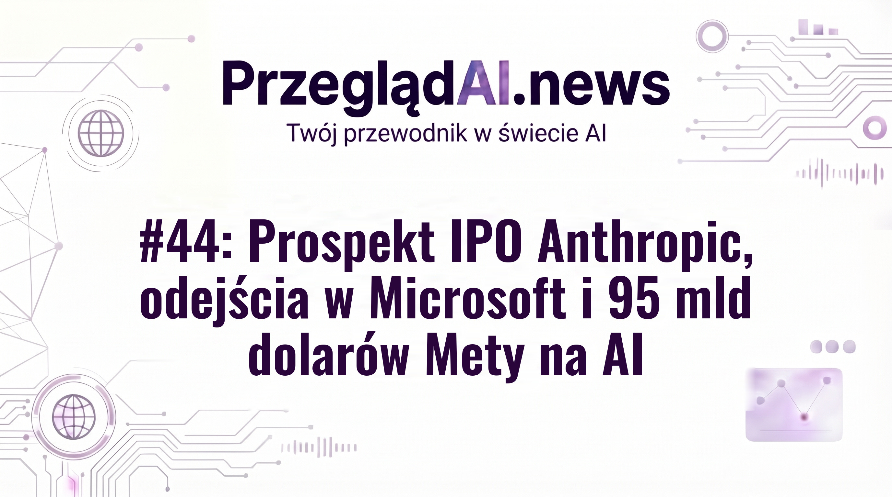
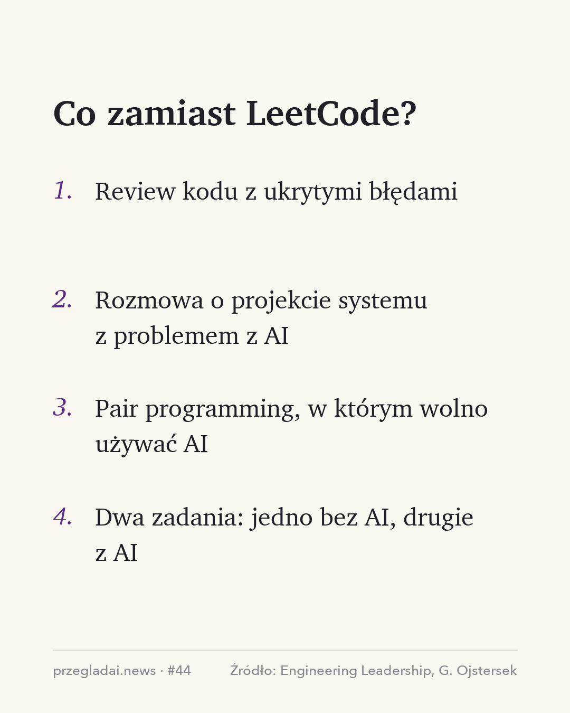
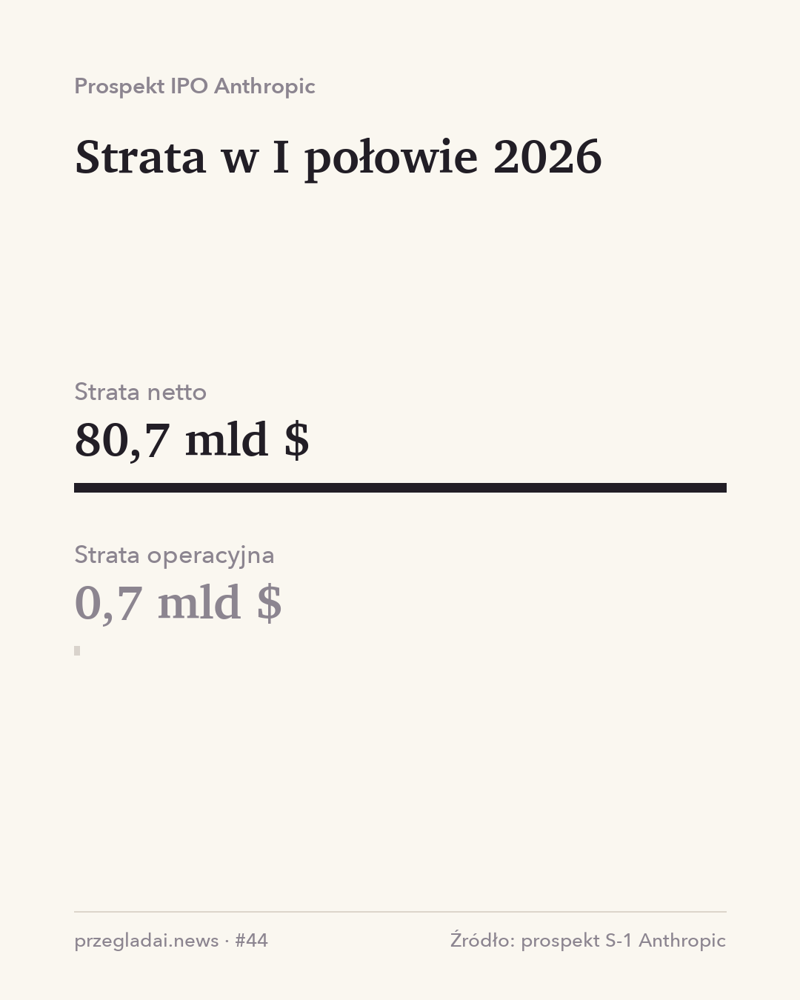

# Posty social — Wydanie #44: Prospekt IPO Anthropic, odejścia w Microsoft i 95 mld dolarów Mety na AI

## 2026-10-30 08:30 — Wstęp wydania

Weryfikacja faktów: 11/11 potwierdzone

### LinkedIn / Facebook / Substack Notes

W jednym tygodniu pojawiły się trzy newsy, które dobrze pokazują, ile kosztuje wyścig AI i kto już na nim zarabia.

Anthropic złożył prospekt przed wejściem na giełdę i po raz pierwszy pokazał pełne liczby. W pierwszym półroczu 2026 roku miał 16,3 mld dolarów przychodu, a klientów płacących mu ponad 100 tys. dolarów rocznie jest już ponad 11,9 tysiąca. Rok wcześniej było ich niewiele ponad 950.

W tym samym tygodniu Microsoft zaproponował dobrowolne odejście około 60 tysiącom pracowników. Tylko w trzecim kwartale jego wydatki inwestycyjne, głównie na centra danych pod AI, miały przekroczyć 50 mld dolarów, więc oszczędności firma szuka w innych miejscach.

Meta z kolei planuje zebrać nawet 95 mld dolarów z emisji akcji, żeby sfinansować rozbudowę swojej infrastruktury AI. Rachunek za ten wyścig robi się naprawdę duży.

Z lżejszych rzeczy: OpenAI wypuściło GPT-6.1 Terra, którego API jest o połowę tańsze od poprzednika ;)

Te i ponad 20 innych newsów z tygodnia zebrałem w 44. wydaniu PrzeglądAI, link w komentarzu.

Ciekawi mnie, czy w Twojej firmie też widać, że budżet na AI zaczyna konkurować z budżetem na zespół?

**Pierwszy komentarz:**

Wydanie #44 PrzeglądAI: https://przegladai.substack.com/p/wydanie-44-prospekt-ipo-anthropic-odejscia-w-microsoft-i-95-mld-dolarow-mety-na-ai

### X (wątek)

1/ W jednym tygodniu trzy newsy, które dobrze pokazują, ile kosztuje wyścig AI i kto już na nim zarabia 👇

2/ Anthropic w prospekcie przed IPO: 16,3 mld $ przychodu w pierwszym półroczu 2026 i ponad 11,9 tys. klientów płacących ponad 100 tys. $ rocznie.

3/ Microsoft proponuje dobrowolne odejście ok. 60 tys. pracowników. Tylko w III kwartale jego wydatki inwestycyjne, głównie na centra danych pod AI, miały przekroczyć 50 mld $. Meta planuje zebrać nawet 95 mld $ z emisji akcji.

4/ Te i ponad 20 innych newsów z tygodnia w #44 PrzeglądAI: https://przegladai.substack.com/p/wydanie-44-prospekt-ipo-anthropic-odejscia-w-microsoft-i-95-mld-dolarow-mety-na-ai

### Obrazek: okladka



---

## 2026-11-03 08:30 — Koniec rekrutacji z LeetCode

Źródło: https://newsletter.eng-leadership.com/p/is-leetcode-dead-whats-the-alternative

Weryfikacja faktów: 12/12 potwierdzone

### LinkedIn / Facebook / Substack Notes

Google testuje w części zespołów nową rundę rozmowy dla juniorów i midów: 200–500 linii cudzego kodu i godzina na znalezienie w nim błędów. W trakcie można korzystać z Gemini.

Ten przykład pochodzi z tekstu Gregora Ojsterseka (newsletter Engineering Leadership) o tym, jak rekrutować programistów, skoro coraz więcej kodu pisze AI. Punktem wyjścia jest LeetCode, czyli platforma z zadaniami algorytmicznymi, na której przez lata ćwiczyło się przed rozmowami w Big Techu.

Sulman Choudhary, szef inżynierii ChatGPT w OpenAI, byłby zdziwiony, gdyby pod koniec 2026 roku firmy dalej prowadziły takie rozmowy, a Felix Rieseberg z Anthropic usunął zadania z kodowania z rozmów w swoim zespole, bo przestały cokolwiek mówić o kandydacie. Big Tech na razie zostaje przy LeetCode, bo łatwo go ocenić i skalować, ale według autora korzysta się z niego coraz rzadziej.

Jako alternatywy artykuł podaje review kodu z ukrytymi błędami i pair programming z AI. Sam autor proponuje dwa zadania: jedno bez AI, żeby sprawdzić podstawy, i drugie z AI, żeby zobaczyć, jak kandydat weryfikuje to, co podsuwa mu model.

Mnie najbardziej przekonuje kierunek, który testuje Google. AI przeniosło dużą część pracy z pisania kodu na czytanie, więc umiejętność zrozumienia cudzego kodu i wyłapania w nim błędów staje się kluczowa. Dla managera ważne jest też to, że taka rozmowa sprawdza pracę, którą nowa osoba będzie robić od pierwszego dnia.

Jak wygląda rozmowa techniczna w Twojej firmie? Dalej są algorytmy, czy już coś bliższego codziennej pracy?

**Pierwszy komentarz:**

Pełny przegląd tygodnia w #44 PrzeglądAI: https://przegladai.substack.com/p/wydanie-44-prospekt-ipo-anthropic-odejscia-w-microsoft-i-95-mld-dolarow-mety-na-ai
Źródło: https://newsletter.eng-leadership.com/p/is-leetcode-dead-whats-the-alternative

### X (wątek)

1/ Google testuje w części zespołów rundę dla juniorów i midów: 200–500 linii cudzego kodu i godzina na znalezienie błędów i omówienie, co by poprawić. Można przy tym korzystać z Gemini.

2/ LeetCode to platforma z zadaniami algorytmicznymi, na której latami ćwiczyło się przed rozmowami w Big Techu. Szef inżynierii ChatGPT w OpenAI byłby zdziwiony, gdyby firmy robiły takie rozmowy jeszcze pod koniec 2026.

3/ Jako alternatywy artykuł podaje review kodu z ukrytymi błędami i pair programming z AI. Gregor Ojstersek proponuje też dwa zadania: jedno bez AI na podstawy, drugie z AI na to, jak kandydat sprawdza wynik modelu.

4/ AI przeniosło dużą część pracy z pisania kodu na czytanie, więc umiejętność zrozumienia cudzego kodu staje się kluczowa. Runda Google sprawdza dokładnie to.

5/ Artykuł: https://newsletter.eng-leadership.com/p/is-leetcode-dead-whats-the-alternative
Ten i inne newsy z tygodnia zebrałem w #44 PrzeglądAI: https://przegladai.substack.com/p/wydanie-44-prospekt-ipo-anthropic-odejscia-w-microsoft-i-95-mld-dolarow-mety-na-ai

### Obrazek: infografika



---

## 2026-11-04 08:30 — Świeże spojrzenie nowej osoby

Źródło: https://felixrieseberg.com/hunger-beats-tenure-advice-for-junior-engineers/

Weryfikacja faktów: 10/10 potwierdzone

### LinkedIn / Facebook / Substack Notes

Felix Rieseberg chciał kiedyś powiesić w biurze Notiona telewizory z dashboardami. Trafił na opór i odpuścił. Rok później nowa osoba zapytała o to samo i telewizory wisiały następnego dnia.

Felix (dziś w Anthropic) opisał to w tekście z radami dla juniorów i przyznał, że przez ten rok sam stał się „starym wyjadaczem”, który wie, czego się w firmie nie da zrobić.

Pisze, że przy pracy z AI staż liczy się mniej niż kiedyś, bo zbudowanie czegoś jest tanie, więc liczy się pomysł i to, czy ktoś zapyta. Claude Code był używany głównie w terminalu, a dwóch stosunkowo nowych inżynierów Anthropic zbudowało w weekend prototyp wersji z interfejsem graficznym. Pierwsza publiczna wersja wyszła około 8 dni później.

Jako manager widzę tu ważny wniosek nie tylko dla juniorów. Nowa osoba przez pierwsze miesiące patrzy na zespół z zewnątrz, więc widzi rzeczy, do których reszta przywykła, i przynosi pomysły z innych firm. Z czasem uczy się, jak działa firma, wchodzi w ten sam schemat i takich pomysłów jest coraz mniej. To naturalne, ale oznacza, że manager ma ograniczony czas, żeby z tego świeżego spojrzenia skorzystać.

Co bym z tym zrobił przy onboardingu:
– poprosił nową osobę o spisanie rzeczy, które ją dziwią, zanim do nich przywyknie,
– na pytanie „czemu tego nie zrobimy?” odpowiadał „sprawdź”, a nie „już próbowaliśmy”,
– dał czas na mały prototyp, zamiast wymagać dokumentu do akceptacji.

Jaką rzecz, którą w Twoim zespole wszyscy uważali za oczywistą, ostatnio podważył ktoś nowy?

**Pierwszy komentarz:**

Pełny przegląd tygodnia w #44 PrzeglądAI: https://przegladai.substack.com/p/wydanie-44-prospekt-ipo-anthropic-odejscia-w-microsoft-i-95-mld-dolarow-mety-na-ai
Źródło: https://felixrieseberg.com/hunger-beats-tenure-advice-for-junior-engineers/

### X (wątek)

1/ Felix Rieseberg chciał kiedyś powiesić w biurze Notiona telewizory z dashboardami, ale trafił na opór i odpuścił. Rok później nowa osoba zapytała o to samo i telewizory wisiały następnego dnia. Felix przyznaje, że przez ten rok sam stał się starym wyjadaczem.

2/ W tekście z radami dla juniorów Felix pisze, że przy pracy z AI staż liczy się mniej, bo zbudowanie czegoś jest tanie. W Anthropic dwóch stosunkowo nowych inżynierów zrobiło w weekend prototyp graficznej wersji Claude Code, a publiczna wersja wyszła ok. 8 dni później.

3/ Widzę tu też wniosek dla managerów. Nowa osoba patrzy na zespół z zewnątrz i przynosi pomysły z innych firm, ale z czasem wchodzi w schemat i przestaje to robić. Jeśli manager nie wykorzysta tego na początku, ten moment po prostu minie.

4/ Dlatego przy onboardingu poprosiłbym nową osobę o listę rzeczy, które ją dziwią, zanim do nich przywyknie. A na pytanie „czemu tego nie zrobimy?” odpowiadałbym „sprawdź”, a nie „już próbowaliśmy”.

5/ Ten i ~25 innych newsów z tygodnia zebrałem w #44 PrzeglądAI: https://przegladai.substack.com/p/wydanie-44-prospekt-ipo-anthropic-odejscia-w-microsoft-i-95-mld-dolarow-mety-na-ai

### Obrazek: prompt

Prompt:

```
Realistic photo, 4:5 vertical (1080x1350). An open-plan software office in soft morning daylight: a large flat TV freshly mounted on a white wall, its screen switched off, a small step ladder still standing next to it, a cardboard box and a coiled HDMI cable on the floor, a drill on a nearby desk. In the background, out-of-focus desks with laptops and a couple of people seen from behind, working. Natural colors, slight film grain, shot on a 35mm lens, candid documentary feel. No text, no logos, no people facing the camera, no robots, no holograms, no 3D render look.
```

---

## 2026-11-05 08:30 — Prospekt Anthropic: strata i tokeny

Źródło: https://www.sec.gov/Archives/edgar/data/2130357/000162828026067168/anthropicpbc-sx1.htm

Weryfikacja faktów: 6/7 potwierdzone — DO SPRAWDZENIA: Spadek wydatków klientów o ok. 20% w dwóch tygodniach do 2 stycznia 2026 (vs dwa poprzednie tygodnie), bo firmy miały świąteczne code freeze'y

### LinkedIn / Facebook / Substack Notes

Anthropic pokazał w prospekcie IPO 80,7 mld dolarów straty netto za pół roku. Brzmi strasznie, ale nie jest to jedyna ciekawa liczba w całym dokumencie.

Prospekt S-1 to dokument, który firma składa w amerykańskiej komisji SEC przed wejściem na giełdę. Opisuje finanse i ryzyka, więc widać w nim, jak zarabia firma od AI.

Wracając do straty: 72,4 mld z tej kwoty to zmiana wyceny not zamiennych i instrumentów pochodnych. Upraszczając: inwestorzy pożyczyli firmie pieniądze z prawem zamiany na akcje. Im wyżej rynek wycenia Anthropic, tym więcej te noty są warte, a w księgach wychodzi z tego „strata”. Sama działalność dała 693 mln dolarów straty operacyjnej.

Ciekawe jest też to, za co firmy płacą. 80% przychodu z półrocza (13,1 mld dolarów) to opłaty za zużyte tokeny, a subskrypcje to 20%. Dobrze widać to w prospekcie: w dwóch tygodniach do 2 stycznia 2026 wydatki klientów spadły o ok. 20%, a prospekt łączy to ze świątecznymi urlopami i code freeze'ami w firmach. Deweloperzy na urlopie, agenci też ;)

Coś wartego uwagi dla managerów: AI w zespole przypomina raczej rachunek za chmurę niż licencję na stanowisko, którą planuje się raz w roku. Prawie połowa sprzedaży Anthropic idzie przez marketplace'y AWS, Google Cloud i Azure, więc często ląduje na tej samej fakturze co serwery.

Dlatego budżet na AI śledziłbym tak jak koszty chmury, czyli per zespół i per projekt. Lepiej zobaczyć skok na dashboardzie niż usłyszeć o nim od działu finansów.

A u Ciebie: stała licencja na osobę czy już płacicie za zużycie tokenów?

**Pierwszy komentarz:**

Pełny przegląd tygodnia w #44 PrzeglądAI: https://przegladai.substack.com/p/wydanie-44-prospekt-ipo-anthropic-odejscia-w-microsoft-i-95-mld-dolarow-mety-na-ai
Źródło: https://www.sec.gov/Archives/edgar/data/2130357/000162828026067168/anthropicpbc-sx1.htm

### X (wątek)

1/ Anthropic złożył w SEC prospekt IPO (S-1). Jest w nim 80,7 mld $ straty netto za pół roku. Brzmi strasznie, ale strata operacyjna to 693 mln $, a resztę robi głównie księgowość.

2/ 72,4 mld $ to głównie zmiana wyceny not zamiennych, czyli pożyczek od inwestorów z prawem zamiany na akcje. Im wyżej rynek wycenia firmę, tym więcej te noty są warte i tym większa „strata” na papierze.

3/ Ciekawe jest też, za co firmy płacą: 80% przychodu Anthropic (13,1 mld $ w półroczu) to opłaty za zużyte tokeny. Subskrypcje to 20%.

4/ Fajny detal z prospektu: w dwóch tygodniach do 2 stycznia wydatki klientów spadły o ok. 20%, a prospekt łączy to ze świątecznymi code freeze'ami. Deweloperzy na urlopie, agenci też.

5/ Coś wartego uwagi dla managerów: AI w zespole działa bardziej jak rachunek za chmurę niż licencja na stanowisko. Dlatego koszty warto śledzić per zespół i projekt, zanim zapyta o nie dział finansów.

6/ Więcej newsów z tygodnia w #44 PrzeglądAI: https://przegladai.substack.com/p/wydanie-44-prospekt-ipo-anthropic-odejscia-w-microsoft-i-95-mld-dolarow-mety-na-ai

### Obrazek: infografika



---
