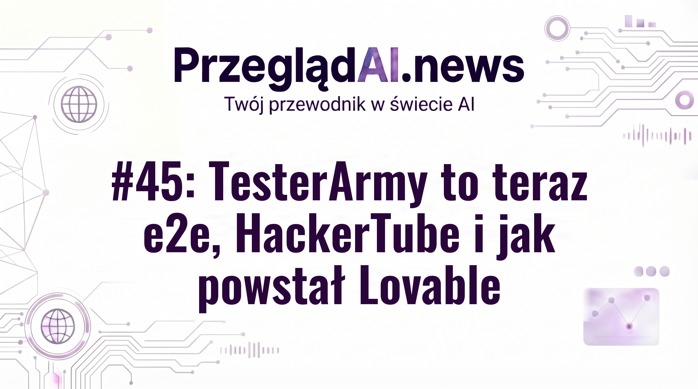
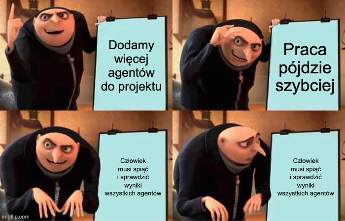

# Posty social — Wydanie #45: TesterArmy to teraz e2e, HackerTube i jak powstał Lovable

## 2026-11-06 09:30 — Wstęp wydania

Weryfikacja faktów: 10/11 potwierdzone — DO SPRAWDZENIA: Karpathy zbudował HackerTube z Claude z 43 mln komentarzy z Hacker News

### LinkedIn / Facebook / Substack Notes

```text
Andrej Karpathy w dwie godziny zbudował z Claude serwis HackerTube. Z 43 milionów komentarzy z Hacker News wyłowił 6454 filmy, które programiści polecają sobie od lat.

Ręcznie zrobił tylko klucz API Google, serwer VPS i domenę. Resztę, razem z wdrożeniem i zabezpieczeniem serwera, wykonał agent.

Obok tego dwa wątki dla każdego, kto buduje z agentami. TesterArmy zmienia nazwę na e2e i zbiera 8 mln dolarów na narzędzie, które sprawdza kod pisany przez agentów. Po miesiącu ma już ponad 1,5 mln pobrań z npm.

Zespół Lovable opisuje z kolei, że wyrzucił większość kodu swoich autonomicznych agentów, bo działały nieprzewidywalnie, i zastąpił go prostym łańcuchem narzędzi.

To i ponad 25 innych newsów z tygodnia zebrałem w 45. wydaniu PrzeglądAI, link w komentarzu.

Czy używałeś/aś e2e w swojej pracy? Jak Tobie się sprawdziło?
```

**Pierwszy komentarz:**

```text
Wydanie #45 PrzeglądAI: https://przegladai.substack.com/p/wydanie-45-testerarmy-to-teraz-e2e-hackertube-i-jak-powstal-lovable
```

### X (wątek)

1/ Andrej Karpathy w dwie godziny zbudował z Claude serwis HackerTube: z 43 mln komentarzy z Hacker News wyłowił 6454 filmy, które programiści polecają sobie od lat.

2/ Ręcznie zrobił tylko klucz API Google, serwer VPS i domenę. Wdrożenie i zabezpieczenie serwera zrobił agent.

3/ Dwa inne wątki dla budujących z agentami: TesterArmy zmienia nazwę na e2e i zbiera 8 mln $ na testowanie kodu pisanego przez agentów. Lovable wyrzucił większość kodu swoich autonomicznych agentów na rzecz prostego łańcucha narzędzi.

4/ To i ponad 25 innych newsów z tygodnia w #45 PrzeglądAI: https://przegladai.substack.com/p/wydanie-45-testerarmy-to-teraz-e2e-hackertube-i-jak-powstal-lovable

### Obrazek: okladka



---

## 2026-11-08 12:00 — Lovable i ciągłe przebudowy

Źródło: https://lovable.dev/blog/how-we-built-lovable-and-why-we-keep-rebuilding-it

Weryfikacja faktów: 6/7 potwierdzone — DO SPRAWDZENIA: „Te zmiany zapadły już po ponad 100 tys. pull requestów” (interpretacja: zmiany nastąpiły po osiągnięciu 100 tys. PR)

### LinkedIn / Facebook / Substack Notes

```text
Użytkownicy Lovable utworzyli do tej pory ponad 70 mln projektów, a mimo to zespół usunął prawie cały kod swoich agentów i wrócił do prostszego schematu pracy.

Lovable to platforma, na której aplikacje powstają w rozmowie z AI. Agent sam planuje kolejne kroki do wykonania. Według firmy takie agenty z dużą swobodą grzęzły w technicznych szczegółach, popełniały błędy i nie dało się przewidzieć, kiedy skończą pracę. Dlatego jedno polecenie użytkownika uruchamia dziś z góry znany ciąg kroków, a nie agenta, który sam decyduje, co robić dalej.

Dobrze widać to na drugim przykładzie z tekstu, z 2024 roku. Zamiast dotrenowywać model, inżynierowie przeglądali logi rozmów z aplikacji, które się psuły, i spisywali krótkie notatki o powtarzających się błędach. Taka notatka brzmi na przykład: „Używaj tylko ikon, które istnieją w bibliotece lucide-react”. Przy każdym nowym zadaniu system wyszukiwał w tych notatkach pasujące fragmenty i dopisywał je do polecenia dla modelu. Zwykły tekst zamiast treningu.

Dziś kod Lovable to ponad 100 tys. pull requestów, więc takie przebudowy dotyczą dużego, żywego projektu, a nie prototypu.

Widzę tu wzorzec, który powtarza się w wielu firmach AI: duża część projektu jest co jakiś czas przebudowywana. Po części dlatego, że modele szybko się zmieniają, ale nie tylko. Człowiek uczy się dopiero na działającym rozwiązaniu, a przebudowa jest dziś tańsza niż kiedyś. Dawniej przebudowa całości trwała długo i kosztowała dużo, więc system planowano tak, żeby jej uniknąć. Teraz łatwiej jest szybko wypuścić działającą wersję, zebrać feedback i zbudować ją od nowa zgodnie z potrzebami użytkowników.

Co możemy z tego wziąć dla siebie: po pierwsze, zawęzić problem, po drugie, kontrolować jego wykonanie, a po trzecie, uczyć się z wyników. Na czym warto się zastanowić: które części naszego rozwiązania najtrudniej byłoby przebudować, gdyby użytkownicy pokazali, że potrzebują czegoś innego?

Czy w Twoim zespole przebudowa rozwiązania jest dziś tańsza niż kilka lat temu i czy zmienia to sposób, w jaki planujecie architekturę?
```

**Pierwszy komentarz:**

```text
Pełny przegląd tygodnia w #45 PrzeglądAI: https://przegladai.substack.com/p/wydanie-45-testerarmy-to-teraz-e2e-hackertube-i-jak-powstal-lovable
Źródło: https://lovable.dev/blog/how-we-built-lovable-and-why-we-keep-rebuilding-it
```

### X (wątek)

1/ Użytkownicy Lovable utworzyli do tej pory ponad 70 mln projektów. Mimo to zespół usunął prawie cały kod swoich agentów i wrócił do prostszego schematu.

2/ Agent sam planuje kolejne kroki. Według firmy takie agenty grzęzły w technicznych szczegółach, popełniały błędy i nie dało się przewidzieć, kiedy skończą. Teraz jedno polecenie uruchamia z góry znany ciąg kroków.

3/ Przykład z 2024: inżynierowie przeglądali logi zepsutych aplikacji i spisywali notatki o błędach, np. „używaj tylko ikon z biblioteki lucide-react”. System dopisywał pasujące notatki do polecenia dla modelu. Bez dotrenowywania.

4/ Widzę tu wzorzec z wielu firm AI: duża część projektu jest co jakiś czas przebudowywana. Nie tylko przez zmiany modeli. Przebudowa jest dziś tańsza, więc może warto szybciej wypuścić działającą wersję, zebrać feedback i zbudować od nowa.

5/ Co z tego wziąć: zawęzić problem, kontrolować jego wykonanie i uczyć się z wyników.
Więcej w #45 PrzeglądAI: https://przegladai.substack.com/p/wydanie-45-testerarmy-to-teraz-e2e-hackertube-i-jak-powstal-lovable

### Obrazek: brak

---

## 2026-11-10 08:30 — Proton i rozmowy o użyciu AI

Źródło: https://www.404media.co/reaping-and-sowing-ceo-edition/

Weryfikacja faktów: 6/6 potwierdzone

### LinkedIn / Facebook / Substack Notes

```text
Szef Protona zaplanował ponowne rozmowy kwalifikacyjne dla niemal wszystkich pracowników i odwołał je dzień po tym, jak sprawa trafiła do mediów.

Według źródeł z firmy osoby, które zarząd uznałby za używające AI za mało, mogłyby stracić pracę. Andy Yen, szef Protona, już wcześniej pisał pracownikom, żeby przestali ręcznie dopieszczać cały kod i częściej korzystali z AI.

Gdy jeden z nich poprosił na kanale o bezpieczeństwie o kilka dni na testy penetracyjne nowego kodu, czyli kontrolowane próby włamania przed wdrożeniem, usłyszał, że to myślenie przegranych, bo można być jednocześnie szybkim i bezpiecznym. Użytkownicy Protona krytykują zarząd w sieci, a część żąda dymisji Yena.

Rozumiem, dlaczego firma chciała to sprawdzić. Zarząd płaci za narzędzia i chce wiedzieć, czy ktoś z nich korzysta, a część ludzi sama z nich nie skorzysta, jeśli nikt ich do tego nie zachęci. Problem w tym, że samo użycie mówi o nawykach, a nie o tym, czy narzędzie pomogło.

Skoro oceniany jest fakt użycia, a nie efekt, ludzie będą używać AI także tam, gdzie im to nie pomaga. Do tego dochodzi strach o pracę: łatwiej pokazać, że się korzysta z AI, niż tłumaczyć, że w danym zadaniu wyszłoby wolniej. Prośba o czas na testy pokazuje, jak łatwo troskę o jakość wziąć za opór.

Na czym warto się zastanowić: o adopcji AI lepiej rozmawiać przez efekty, na przykład czas dostarczania, liczbę błędów i jakość code review, i pytać zespół, co narzędzie ułatwiło, a gdzie przeszkadza.

Jak u Ciebie w zespole jest oceniane, jak dobrze ludzie używają AI i czy wiedzą, kiedy narzędzie pomaga, a kiedy przeszkadza?
```

**Pierwszy komentarz:**

```text
Pełny przegląd tygodnia w #45 PrzeglądAI: https://przegladai.substack.com/p/wydanie-45-testerarmy-to-teraz-e2e-hackertube-i-jak-powstal-lovable
Źródło: https://www.404media.co/reaping-and-sowing-ceo-edition/
```

### X (wątek)

1/ Szef Protona zaplanował ponowne rozmowy kwalifikacyjne dla niemal wszystkich pracowników. Odwołał je dzień po tym, jak sprawa trafiła do mediów.

2/ Według źródeł z firmy osoby używające AI za mało mogły stracić pracę. Szef wcześniej pisał, żeby przestać ręcznie dopieszczać kod i używać AI częściej.

3/ Prośbę o kilka dni na testy penetracyjne nowego kodu usłyszał jako myślenie przegranych. Rozumiem, że firma chce sprawdzać, czy korzysta z narzędzi, za które płaci.

4/ Ale gdy oceniany jest fakt użycia, a nie efekt, ludzie używają AI także tam, gdzie im to nie pomaga.

5/ Lepiej rozmawiać o efektach: czas dostarczania, liczba błędów, jakość code review. I pytać zespół, co ułatwiło, a co przeszkadza. Jak to oceniacie u siebie?
Więcej w #45 PrzeglądAI: https://przegladai.substack.com/p/wydanie-45-testerarmy-to-teraz-e2e-hackertube-i-jak-powstal-lovable

### Obrazek: brak

---

## 2026-11-10 08:30 — Cisco: tokeny bez limitu na stary kod

Źródło: https://www.tomshardware.com/tech-industry/big-tech/cisco-gives-27-year-old-engineer-unlimited-ai-tokens-to-rewrite-98-percent-of-the-companys-legacy-code-in-24-months-president-plucks-former-startup-founder-telling-him-to-go-nuts

Weryfikacja faktów: 14/14 potwierdzone

### LinkedIn / Facebook / Substack Notes

```text
Były założyciel przejętego przez Cisco startupu EzDubs dostał nieograniczone tokeny AI i 24 miesiące na przepisanie 98% starego kodu firmy.

Decyzję podjął prezes i dyrektor produktowy Cisco, który powiedział 27-letniemu inżynierowi, żeby "poszedł na całość". Plan inżyniera to praca w dwuosobowym zespole i cztery tygodnie na pokazanie, że to podejście działa.

Brak limitu na tokeny oznacza brak sufitu kosztów pracy agentów i trudno mi uwierzyć, że górnej granicy naprawdę nie ma. Twórca OpenClaw po przejściu do OpenAI wydał w 30 dni około 1,3 mln dolarów na tokeny: 603 mld tokenów, około 100 instancji Codexa i trzy osoby do nadzoru, a rachunek pokrywa OpenAI. Skala potrafi więc być ogromna, ale zakładam, że ktoś w Cisco prędzej czy później spojrzy na rachunek.

Zazwyczaj tak duże migracje trwają bardzo długo, więc cel jest bardzo ambitny. Zastanawiam się, czy problemem będzie samo przepisanie kodu na nowo, czy raczej wdrażanie go krok po kroku i sprawdzanie każdego kawałka tak, żeby firma działała bez zmian. Agent napisze nową wersję modułu szybko, ale ktoś musi wykazać, że zachowuje się przynajmniej tak dobrze, jak starsza wersja.

Przed takim eksperymentem dobrze ustalić, po czym poznamy, że to naprawdę działa i można to puścić na produkcję. Ważniejszy od samego przepisania jest plan, jak potem wcielić nowy kod w życie: który fragment przełączamy pierwszy, jak porównujemy wyniki ze starym systemem i jak wracamy, gdy coś pójdzie nie tak.

Czy techniki znane od lat, jak strangler pattern (stopniowe zastępowanie starych kawałków systemu nowymi), wzmocnione AI, mogą dać bardzo dobre efekty przy przepisywaniu kodu?
```

**Pierwszy komentarz:**

```text
Pełny przegląd tygodnia w #45 PrzeglądAI: https://przegladai.substack.com/p/wydanie-45-testerarmy-to-teraz-e2e-hackertube-i-jak-powstal-lovable
Źródło: https://www.tomshardware.com/tech-industry/big-tech/cisco-gives-27-year-old-engineer-unlimited-ai-tokens-to-rewrite-98-percent-of-the-companys-legacy-code-in-24-months-president-plucks-former-startup-founder-telling-him-to-go-nuts
Koszty tokenów twórcy OpenClawa: https://thenextweb.com/news/openclaw-peter-steinberger-1-3-million-openai-token-bill
```

### X (wątek)

1/ Były założyciel przejętego przez Cisco startupu EzDubs dostał nieograniczone tokeny AI i 24 miesiące na przepisanie 98% starego kodu firmy.

2/ Decyzję podjął prezes i dyrektor produktowy Cisco: inżynier ma iść na całość. Jego plan to dwuosobowy zespół i cztery tygodnie na pokazanie, że to działa.

3/ Brak limitu na tokeny to brak sufitu kosztów. Twórca OpenClawa wydał w 30 dni ok. 1,3 mln dolarów na tokeny OpenAI (603 mld tokenów, ok. 100 instancji Codexa). Ktoś w Cisco i tak zerknie na rachunek.

4/ Takie migracje zwykle trwają bardzo długo. Problemem może być nie samo przepisanie, tylko wdrażanie krok po kroku tak, żeby firma działała bez zmian. Warto z góry ustalić, po czym poznamy, że nowy kod działa.

5/ Czy strangler pattern wzmocniony AI da bardzo dobre efekty przy przepisywaniu kodu? Więcej newsów z tygodnia w #45 PrzeglądAI: https://przegladai.substack.com/p/wydanie-45-testerarmy-to-teraz-e2e-hackertube-i-jak-powstal-lovable

### Obrazek: brak

---

## 2026-11-12 08:30 — Prawo Brooksa dla agentów AI

Źródło: https://j11g.com/the-mythical-man-month-in-the-age-of-ai

Weryfikacja faktów: 6/7 potwierdzone — DO SPRAWDZENIA: Wąskim gardłem robi się człowiek, który spina pracę agentów i wyznacza tempo; więcej agentów to mniej czasu na ocenę jakości, więc jakość może spadać

### LinkedIn / Facebook / Substack Notes

```text
W 1975 roku Frederick Brooks napisał w książce „The Mythical Man-Month”, że dodanie ludzi do spóźnionego projektu spóźni go jeszcze bardziej.

Przy agentach AI wydaje się, że ten problem znika. Nie potrzebują onboardingu ani spotkań, a właśnie z nich brały się koszty dokładania ludzi. Tyle że praca sekwencyjna jest dalej sekwencyjna: dziewięciu agentów nie zrobi dziecka w miesiąc. Kiedyś to brzmiało lepiej 😅

Kolejni agenci mogą też zacząć sobie przeszkadzać. Kilku agentów w jednym repozytorium bez orkiestracji potrafi nadpisywać nawzajem swoją pracę. A koszt koordynacji nie znika, tylko przechodzi na człowieka: ktoś musi określić, co znaczy „gotowe”, sprawdzić wyniki i złożyć części w całość.

Wąskim gardłem robi się więc człowiek, który to wszystko spina, i to on wyznacza tempo. Im więcej agentów, tym więcej koordynacji spada na niego, a tym mniej zostaje czasu na ocenę jakości. Dlatego dokładanie kolejnych agentów może obniżać jakość, nawet jeśli kodu przybywa szybciej.

Co możemy z tego wziąć dla siebie: najpierw rozbić pracę na kawałki i zastanowić się, które da się zrobić naprawdę niezależnie. Potem dać każdemu agentowi osobny krok, a nie fragment tego samego pliku. Warto też ustalić kontrakty między nimi, czyli co jeden oddaje drugiemu (np. interfejs albo format danych) i po czym poznać, że skończył. Bez jasnych wymagań dostaniemy po prostu złą odpowiedź szybciej.

W którym momencie dokładanie AI, w jakiejkolwiek formie, przestaje zwiększać wydajność i jakość, a zaczyna je pogarszać, np. przez ciągłe przełączanie kontekstu?
```

**Pierwszy komentarz:**

```text
Pełny przegląd tygodnia w #45 PrzeglądAI: https://przegladai.substack.com/p/wydanie-45-testerarmy-to-teraz-e2e-hackertube-i-jak-powstal-lovable
Źródło: https://j11g.com/the-mythical-man-month-in-the-age-of-ai
```

### X (wątek)

1/ W 1975 roku Frederick Brooks napisał, że dodanie ludzi do spóźnionego projektu spóźni go jeszcze bardziej. Agenci AI nie potrzebują onboardingu ani spotkań, więc czy ten problem znika?

2/ Niezupełnie. Praca sekwencyjna dalej jest sekwencyjna: dziewięciu agentów nie zrobi dziecka w miesiąc. A kilku agentów w jednym repozytorium bez orkiestracji potrafi nadpisywać sobie pracę.

3/ Koszt koordynacji nie znika, tylko przechodzi na człowieka. Ktoś musi określić, co znaczy „gotowe”, sprawdzić wyniki i złożyć części. To on staje się wąskim gardłem i wyznacza tempo.

4/ Więcej agentów to więcej koordynacji i mniej czasu na ocenę jakości. Dlatego najpierw podziel pracę na niezależne kroki i ustal kontrakty między agentami: co kto oddaje i po czym wiadomo, że skończył.

5/ Gdzie u Was dokładanie AI przestaje zwiększać wydajność i jakość, a zaczyna je pogarszać? Ten temat i inne newsy z tygodnia: https://przegladai.substack.com/p/wydanie-45-testerarmy-to-teraz-e2e-hackertube-i-jak-powstal-lovable

### Obrazek: mem



Mem: Gru's Plan (https://imgflip.com/memegenerator/Grus-Plan)

```
1: Dodamy więcej agentów do projektu
2: Praca pójdzie szybciej
3: Człowiek musi spiąć i sprawdzić wyniki wszystkich agentów
4: Człowiek musi spiąć i sprawdzić wyniki wszystkich agentów
```

---
