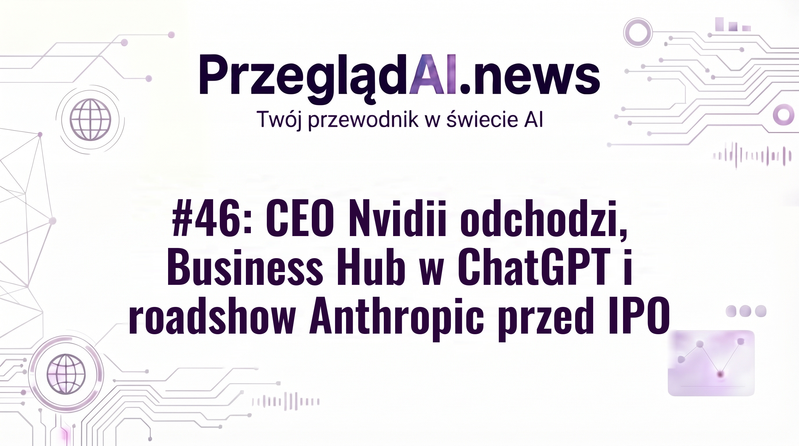

# Posty social — Wydanie #46: CEO Nvidii odchodzi, Business Hub w ChatGPT i roadshow Anthropic przed IPO

## [OPUBLIKOWANE] 2026-11-13 09:30 — Wstęp wydania

Weryfikacja faktów: 13/14 potwierdzone — DO SPRAWDZENIA: Spójność: pytanie na końcu (o wygląd firmy w odpowiedziach ChatGPT) dotyczy Business Hub, a nie głównej tezy posta (odejście Huanga z Nvidii)

### LinkedIn / Facebook / Substack Notes

```text
Jensen Huang przestał być szefem Nvidii, spółki wartej jeszcze niedawno ponad 4 bln dolarów, którą współzałożył w 1993 roku. Tymczasowo kieruje nią dyrektor finansowa Colette Kress, a zarząd szuka następcy.

Odejście poprzedziły doniesienia o romansach, w tym z kobietą podejrzewaną o powiązania z chińskim wywiadem. Akcje spadły w kilka dni o kilkanaście procent, a Nvidia dostarcza chipy między innymi dla OpenAI i Anthropic.

Obok tego dwa wątki z tego tygodnia. OpenAI uruchamia w ChatGPT Business Hub: firmy zgłaszają swoją markę, dodają katalogi produktów z cenami i dostępnością, a zweryfikowani sprzedawcy w USA mogą uruchomić własnego agenta do rozmów z klientami. Anthropic rusza natomiast z roadshow przed IPO i oferuje 825 mln akcji w przedziale 70–78 dolarów.

To i ponad 25 innych newsów z tygodnia zebrałem w 46. wydaniu PrzeglądAI, link w komentarzu.

Czy sprawdzałeś/aś już, jak Twoja firma wygląda w odpowiedziach ChatGPT?
```

**Pierwszy komentarz:**

```text
Wydanie #46 PrzeglądAI: https://przegladai.substack.com/p/wydanie-46-ceo-nvidii-odchodzi-business-hub-w-chatgpt-i-roadshow-anthropic-przed-ipo
```

### X (wątek)

1/ Jensen Huang przestał być szefem Nvidii, spółki wartej jeszcze niedawno ponad 4 bln dolarów. Tymczasowo kieruje nią dyrektor finansowa Colette Kress, a zarząd szuka następcy. Akcje spadły w kilka dni o kilkanaście procent.

2/ OpenAI uruchamia w ChatGPT Business Hub: firmy zgłaszają markę i dodają katalogi produktów z cenami i dostępnością. W USA zweryfikowani sprzedawcy mogą też uruchomić własnego agenta do rozmów z klientami.

3/ Anthropic ruszył z roadshow przed IPO: 825 mln akcji klasy A w przedziale 70–78 dolarów. Papiery mają trafić na Nasdaq pod symbolem ANT.

4/ To i ponad 25 innych newsów z tygodnia w #46 PrzeglądAI: https://przegladai.substack.com/p/wydanie-46-ceo-nvidii-odchodzi-business-hub-w-chatgpt-i-roadshow-anthropic-przed-ipo

### Obrazek: okladka



---

## [OPUBLIKOWANE] 2026-11-15 15:00 — Bezpieczny SQL od LLM-a

Źródło: https://www.infoworld.com/article/4244721/your-llm-writes-good-sql-thats-not-the-same-as-safe-sql.html

Weryfikacja faktów: 10/11 potwierdzone — DO SPRAWDZENIA: Spójność: test na danych syntetycznych

### LinkedIn / Facebook / Substack Notes

```text
W teście 900 zapytań do bazy z danymi farmaceutycznymi AI zwróciło nawet około 80 wierszy, do których pytający nie miał dostępu.

Narzędzie analityczne, zbudowane na Snowflake Cortex, zamienia pytania w języku naturalnym na SQL. Handlowiec pyta o sprzedaż w „swoich szpitalach” i dostaje dane z całego regionu. Zapytanie jest poprawne i odpowiada na pytanie, tylko nikt nie sprawdził, kto je zadał.

Wycieki zniknęły dopiero wtedy, gdy między pytaniem a bazą stanął pilnujący kod. Sprawdza każde zapytanie, zanim trafi do bazy, i w razie potrzeby je poprawia: dopisuje filtr, żeby handlowiec widział tylko swoje szpitale, ukrywa wrażliwe kolumny, a część zapytań blokuje albo oddaje człowiekowi do decyzji. Takie sprawdzanie zajęło w teście około 6,5 ms na zapytanie, więc użytkownik nie odczuje różnicy, a z bazy nie wyciekł już żaden wiersz.

Zapisanie reguł w prompcie tego nie załatwiło, bo prompt jest tylko sugestią, a model nie musi się do niej stosować. Nie wystarczyły też zwykłe, statyczne role dostępu, bo nie wiedzą, o co dokładnie ktoś pyta. Jak się okazało, ponad połowa zapytań wymagała jakiejś interwencji.

Widzę tu coś szerszego niż problem z dostępami. Narzędzie generowane przez AI na demo wygląda świetnie: pytasz, po sekundzie masz wynik. Nic się nie psuje, nikt nie dostaje błędu, więc łatwo uznać, że „zrobione” znaczy „dobrze zrobione”. Poprawianie po AI trudno pokazać tak, jak pierwszą wersję, bo jego efektem jest to, że nic złego się nie stało.

Tyczy się to nie tylko SQL-a. Wygenerowanie dashboardu dla zebranych danych – krótki prompt, parę minut i mamy ładną, graficzną prezentację w HTML. Tylko czy masz pewność, że dane, które są prezentowane, są poprawne? Generowanie kodu – odpalasz aplikację, działa. Jednocześnie w kodzie widać jawne tworzenie nowych wątków, które przeciążą aplikację, gdy tylko pojawi się na niej ruch.

To właśnie ta weryfikacja, poprawianie, review, umiejętność odpowiedniego pokierowania AI i nauczanie go na przykładach są kluczowe, aby uzyskać jakościowe wyniki i nabrać efektu kuli śnieżnej, by każde kolejne zadanie było wykonywane coraz bardziej jakościowo przez AI.
Tylko pozostaje jeszcze duże wyzwanie do zaadresowania – jak pokazać wartość tej pracy interesariuszom?

Jak u Ciebie pokazuje się wartość pracy, po której nic złego się nie wydarzyło?
```

**Pierwszy komentarz:**

```text
Pełny przegląd tygodnia w #46 PrzeglądAI: https://przegladai.substack.com/p/wydanie-46-ceo-nvidii-odchodzi-business-hub-w-chatgpt-i-roadshow-anthropic-przed-ipo
Źródło: https://www.infoworld.com/article/4244721/your-llm-writes-good-sql-thats-not-the-same-as-safe-sql.html
```

### X (wątek)

1/ W teście 900 zapytań do bazy z danymi farmaceutycznymi AI zwróciło nawet około 80 wierszy, do których pytający nie miał dostępu. Handlowiec pytał o „swoje szpitale” i dostał dane z całego regionu. Zapytanie było poprawne, tylko nikt nie sprawdził, kto je zadał.

2/ Wycieki zniknęły dopiero, gdy między pytaniem a bazą stanął pilnujący kod: dopisuje filtry, ukrywa wrażliwe kolumny, a część zapytań blokuje albo oddaje człowiekowi. Kosztowało to około 6,5 ms na zapytanie. Reguły w prompcie nie wystarczyły, bo prompt to tylko sugestia.

3/ Nie wystarczyły też statyczne role dostępu, bo nie wiedzą, o co dokładnie ktoś pyta. Jak się okazało, ponad połowa zapytań wymagała jakiejś interwencji.

4/ Takie narzędzie na demo wygląda świetnie: pytasz, po sekundzie masz wynik. Nic się nie psuje i nikt nie dostaje błędu, więc łatwo uznać, że „zrobione” to „dobrze zrobione”. Poprawianie po AI trudno pokazać, bo jego efektem jest to, że nic złego się nie stało.

5/ Dotyczy to nie tylko SQL-a. Dashboard w HTML z krótkiego promptu wygląda ładnie, ale czy dane są poprawne? Aplikacja po uruchomieniu działa, a w kodzie widać tworzenie nowych wątków, które przeciążą ją, gdy pojawi się ruch.

6/ Weryfikacja, review i uczenie AI na przykładach decydują o jakości. Wyzwanie: jak pokazać wartość tej pracy interesariuszom? Jak u Ciebie pokazuje się wartość pracy, po której nic złego się nie wydarzyło? Więcej: https://przegladai.substack.com/p/wydanie-46-ceo-nvidii-odchodzi-business-hub-w-chatgpt-i-roadshow-anthropic-przed-ipo

### Obrazek: brak

---
