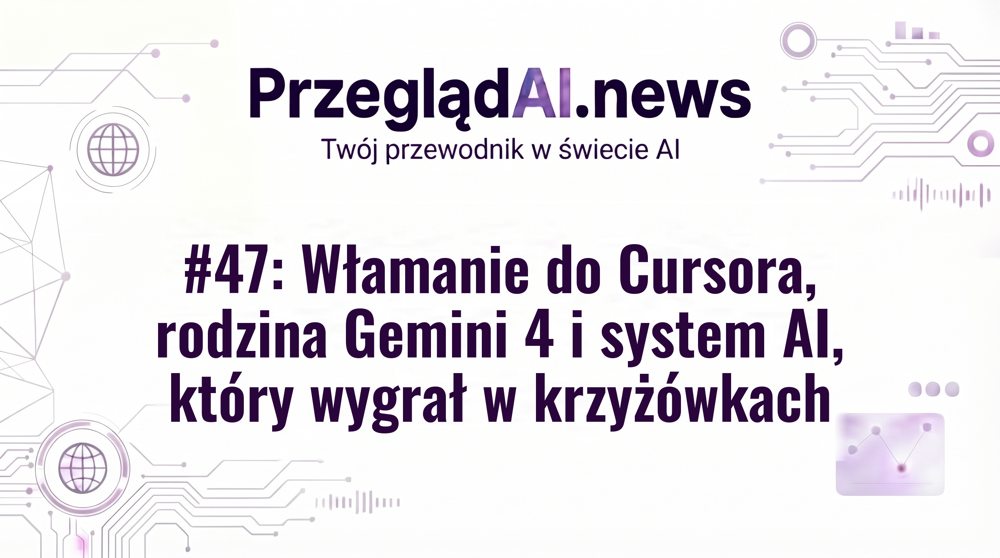
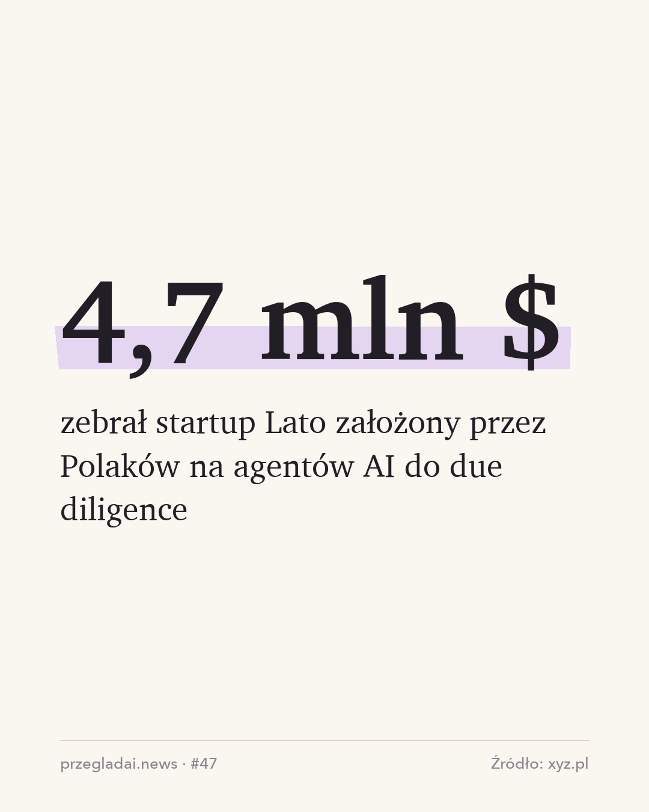
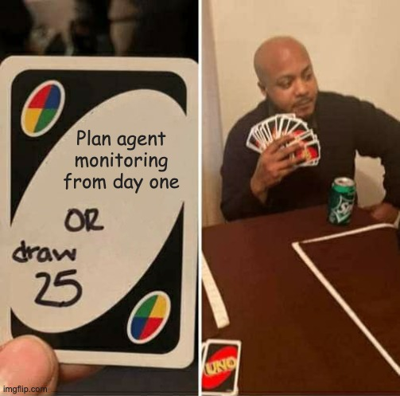

# Posty social — Wydanie #47: Włamanie do Cursora, rodzina Gemini 4 i system AI, który wygrał w krzyżówkach

## [OPUBLIKOWANE] 2026-11-20 09:30 — Wstęp wydania

Weryfikacja faktów: 10/11 potwierdzone — DO SPRAWDZENIA: Napastnik skopiował z magazynu dane z sesji agentów kodujących z 2025 roku

### LinkedIn / Facebook / Substack Notes

```text
W marketplace Cursora przez około 11 godzin było złośliwe rozszerzenie Claude Code. Atak zaczął się od klucza dostępu, który ujawnił zewnętrzny dostawca.

Cursor opisał to w raporcie po incydencie. Napastnik skopiował z magazynu dane z sesji agentów kodujących, głównie z 2025 roku, a w nich czasem leżały niezamaskowane poświadczenia. Dzięki nim dotarł do wybranych narzędzi firmy. Ślady sesji wyciekły w przypadku mniej niż 0,05% użytkowników bez Privacy Mode.

Obok tego dwa wątki z tego tygodnia. Google pokazało Gemini 4 Hydrogen, który według firmy kończy zadania około 2,5 raza szybciej niż Gemini 3.8 Flash. A system Darmok, według autorów pracy, rozwiązał na mistrzostwach w Londynie wszystkie siedem krzyżówek kryptycznych szybciej niż każdy człowiek.

Z historii Cursora wynika dla mnie jedna praktyczna rzecz: do rozmów z agentem trafiają sekrety, więc warto przejrzeć, jakie klucze mają Twoi agenci, i ustalić, kto je rotuje po incydencie ;)

To i ponad 25 innych newsów z tygodnia zebrałem w 47. wydaniu PrzeglądAI, link w komentarzu.

Czy Twoi agenci mają dostęp do kluczy produkcyjnych?
```

**Pierwszy komentarz:**

```text
Wydanie #47 PrzeglądAI: https://przegladai.substack.com/p/wydanie-47-wlamanie-do-cursora-rodzina-gemini-4-i-system-ai-ktory-wygral-w-krzyzowkach
```

### X (wątek)

1/ W marketplace Cursora przez około 11 godzin było złośliwe rozszerzenie Claude Code. Atak zaczął się od klucza dostępu, który ujawnił zewnętrzny dostawca.

2/ Napastnik skopiował z magazynu dane z sesji agentów kodujących, głównie z 2025 roku. W części z nich leżały niezamaskowane poświadczenia. Ślady sesji wyciekły w przypadku mniej niż 0,05% użytkowników bez Privacy Mode.

3/ Poza tym: Według Google Gemini 4 Hydrogen kończy zadania około 2,5 raza szybciej niż Gemini 3.8 Flash, a według autorów pracy system Darmok rozwiązał na mistrzostwach w Londynie wszystkie siedem krzyżówek kryptycznych.

4/ Sprawdź, jakie klucze mają Twoi agenci. To i ponad 25 innych newsów z tygodnia w #47 PrzeglądAI: https://przegladai.substack.com/p/wydanie-47-wlamanie-do-cursora-rodzina-gemini-4-i-system-ai-ktory-wygral-w-krzyzowkach

### Obrazek: okladka



---

## [OPUBLIKOWANE] 2026-11-22 10:30 — Lato: agenci AI w due diligence

Źródło: https://xyz.pl/polacy-ze-startupu-lato-maja-47-mln-dolarow-na-rozwoj-i-platforme-ai-za-ktora-klienci-gotowi-sa-placic/

Weryfikacja faktów: 12/12 potwierdzone

### LinkedIn / Facebook / Substack Notes

```text
Założony przez Polaków startup Lato pozyskał 4,7 mln dolarów na agentów AI, którzy sami dzwonią do klientów i ekspertów spółki, jaką fundusz zamierza kupić.

To runda seed, prowadzona przez Air Street Capital i Axiom Partners. Lato automatyzuje commercial due diligence, czyli badanie pozycji rynkowej firmy przed inwestycją. Zwykle robią to konsultanci, którzy według Lato biorą za kilka tygodni pracy 300 tys. dolarów i więcej.

Agenci sami szukają rozmówców, prowadzą z nimi rozmowy głosowe i łączą wyniki z danymi funduszu. Firma twierdzi, że skraca proces z tygodni do kilku godzin, a po stu dniach tempo sprzedaży odpowiada rocznym przychodom powyżej 1 mln dolarów. 

Najbardziej interesuje mnie jednak coś innego: analiza trafia do klienta razem z nagraniami i transkrypcjami rozmów. Przy decyzji o zakupie spółki nikt nie zaufa wnioskowi „bo tak policzył agent”, skoro ktoś będzie musiał za niego odpowiadać. Dzięki nagraniom wniosek da się prześledzić do konkretnej wypowiedzi.

To nie usuwa ryzyka. Prawnik cytowany w artykule zwraca uwagę na halucynacje i poufność danych, a inni na błędy w rozmowach agentów z ludźmi, zwłaszcza na początku. Nagrania pozwalają jednak te błędy znaleźć, zamiast ich nie widzieć.

Przy własnych agentach dobrze ustalić od początku, do czego wynik ma się dać prześledzić i kto na to znajdzie czas. Skrócenie pracy z tygodni do godzin działa tylko wtedy, gdy sprawdzenie wyniku nie zjada całej oszczędności.

Czy w narzędziach AI, z których korzystasz, da się dojść od wyniku do źródła, czy trzeba wierzyć na słowo?
```

**Pierwszy komentarz:**

```text
Pełny przegląd tygodnia w #47 PrzeglądAI: https://przegladai.substack.com/p/wydanie-47-wlamanie-do-cursora-rodzina-gemini-4-i-system-ai-ktory-wygral-w-krzyzowkach
Źródło: https://xyz.pl/polacy-ze-startupu-lato-maja-47-mln-dolarow-na-rozwoj-i-platforme-ai-za-ktora-klienci-gotowi-sa-placic/
```

### X (wątek)

1/ Założony przez Polaków startup Lato pozyskał 4,7 mln dolarów na agentów AI, którzy sami dzwonią do klientów i ekspertów spółki, jaką fundusz chce kupić. Robią commercial due diligence, czyli badanie pozycji rynkowej firmy przed inwestycją.

2/ Konsultanci biorą za takie badanie według Lato 300 tys. dolarów i więcej za kilka tygodni pracy. Firma twierdzi, że jej agenci robią to w kilka godzin. To twierdzenia firmy, których nikt jeszcze niezależnie nie sprawdził.

3/ Ciekawsze od szybkości: analiza trafia do klienta z nagraniami i transkrypcjami rozmów. Przy decyzji o zakupie spółki nikt nie zaufa wnioskowi „bo agent tak policzył”. Musi być do czego wrócić.

4/ Nagrania nie usuwają ryzyka halucynacji czy błędów w rozmowach agentów z ludźmi, ale pozwalają je znaleźć. Przy własnych agentach warto zapytać: czy da się prześledzić wynik do źródła i kto ma na to czas?

5/ Szerzej o tym i ponad 25 innych newsach z tygodnia w #47 PrzeglądAI: https://przegladai.substack.com/p/wydanie-47-wlamanie-do-cursora-rodzina-gemini-4-i-system-ai-ktory-wygral-w-krzyzowkach

### Obrazek: infografika



---

## [OPUBLIKOWANE] 2026-11-25 20:00 — LangChain: 300 mln i pilnowanie agentów

Źródło: https://www.wsj.com/cio-journal/ai-startup-langchain-more-than-doubles-its-valuation-to-3-billion-f83377ad

### LinkedIn / Facebook / Substack Notes

```text
LangChain, twórca platformy do budowy agentów AI, zebrał 300 mln dolarów przy wycenie 3 mld, ponad dwa razy wyższej niż rok temu. Pieniądze mają trafić do LangSmith, czyli narzędzia do pilnowania agentów.

Rundę poprowadził CapitalG, fundusz Alphabet. LangSmith służy do monitorowania, oceny i wdrażania agentów w firmach i według LangChain używa go ponad 7 tysięcy organizacji. Szef firmy mówi wprost, że to zachowanie agenta jest tym, co najtrudniej kontrolować.

Zwróciłbym uwagę na przykład, który LangChain podaje o Workday: czas wdrożenia nowego agenta miał spaść z pięciu miesięcy do mniej niż jednego dnia. To deklaracja dostawcy, więc traktowałbym ją ostrożnie. Pokazuje jednak, gdzie leży koszt. W wielu firmach największym kosztem nie jest zbudowanie prototypu agenta, tylko zgoda na wpuszczenie go na produkcję, a następnie kontrolowanie go.

Oczywiście start-up sprzedający takie narzędzie będzie mówił, że najtrudniejszy jest właśnie ten etap. Mimo to coś w tym jest: im łatwiej pisać agentów, tym więcej ich powstaje, a każdego trzeba potem sprawdzać, mierzyć i pilnować.

Przy planowaniu kolejnego agenta dobrze od razu wpisać do budżetu i harmonogramu ewaluację oraz monitoring, a nie traktować ich jako dodatek na koniec. Dobrze też zawczasu ustalić, po czym poznamy, czy agent po zmianie modelu albo promptu nadal robi to samo, co wcześniej.

Jak u Ciebie sprawdza się, czy agent po zmianie modelu nadal działa tak jak przed nią?
```

**Pierwszy komentarz:**

```text
Pełny przegląd tygodnia w #47 PrzeglądAI: https://przegladai.substack.com/p/wydanie-47-wlamanie-do-cursora-rodzina-gemini-4-i-system-ai-ktory-wygral-w-krzyzowkach
Źródło: https://www.wsj.com/cio-journal/ai-startup-langchain-more-than-doubles-its-valuation-to-3-billion-f83377ad
Wpis LangChain o rundzie i TNW: https://thenextweb.com/news/langchain-300m-series-c-3bn-valuation-capitalg-langsmith
```

### X (wątek)

1/ LangChain zebrał 300 mln dolarów przy wycenie 3 mld, ponad dwa razy wyższej niż rok temu. Rundę poprowadził CapitalG z Alphabet.

2/ Pieniądze mają trafić w LangSmith, czyli narzędzie do monitorowania, oceny i wdrażania agentów w firmach. Według LangChain używa go ponad 7 tys. organizacji.

3/ Szef firmy mówi, że najtrudniej kontrolować zachowanie agenta. Według LangChain Workday skrócił wdrożenie nowego agenta z pięciu miesięcy do mniej niż dnia, ale to deklaracja dostawcy.

4/ Wygląda na to, że koszt agenta nie leży w napisaniu go, tylko w pilnowaniu. Warto zaplanować ewaluację i monitoring od razu, razem z samym agentem.

5/ Cały przegląd tygodnia w #47 PrzeglądAI: https://przegladai.substack.com/p/wydanie-47-wlamanie-do-cursora-rodzina-gemini-4-i-system-ai-ktory-wygral-w-krzyzowkach

### Obrazek: mem



Mem: UNO Draw 25 Cards (https://imgflip.com/memegenerator/UNO-Draw-25-Cards)

```
karta: Zaplanować monitoring agenta od pierwszego dnia
opcja: Dobrać 25 kart nieplanowanych poprawek
```

---

## 2026-11-26 08:30 — Devin Apps: prywatne narzędzia od agenta

Źródło: https://devin.ai/blog/devin-apps

### LinkedIn / Facebook / Substack Notes

```text
Devin potrafi teraz zbudować prywatną aplikację webową na podstawie opisu i wystawić ją pod stałym linkiem. Dostęp mają tylko zalogowani użytkownicy Devina, a aplikacje nigdy nie są publiczne.

Opisujesz, czego zespół potrzebuje, na przykład panel administracyjny, dashboard z metrykami albo kolejkę akceptacji. Agent pisze kod i wdraża go na swojej maszynie w chmurze. Kolejne zmiany wchodzą pod tym samym adresem, a gdy nowa wersja się nie uruchomi, dalej działa poprzednia. Dane można odświeżać według harmonogramu, a aplikację udostępnić wybranym osobom, całej organizacji albo firmie.

Twórcy sami zaznaczają, że to narzędzie do zastosowań wewnętrznych, a nie do ruchu produkcyjnego: każda aplikacja działa na jednej maszynie, która usypia, gdy nikt jej nie używa, więc pierwsze otwarcie może zająć kilka sekund. Płaci się za czas, kiedy maszyna jest włączona.

Najciekawsze nie jest dla mnie to, że agent napisze dashboard, bo to potrafi dziś wiele narzędzi. Ciekawsze jest to, że od razu dostajesz hosting, logowanie i wersje. Zwykle właśnie to powodowało, że małe narzędzie nigdy nie powstawało i zostawał arkusz: ktoś musiałby je gdzieś postawić, zabezpieczyć i utrzymywać. Z drugiej strony arkusz nie potrzebuje właściciela, a aplikacja tak. Do tego aplikacje mogą korzystać z Twoich integracji i repozytorium, więc trzeba wiedzieć, do czego mają dostęp.

Zanim zespoły zaczną budować takie narzędzia na potęgę, dobrze ustalić trzy rzeczy: jakie dane wolno w nich pokazywać, kto jest ich właścicielem i po czym poznamy, że narzędzie przestało być „małe” i trzeba je przenieść do normalnego procesu.
```

**Pierwszy komentarz:**

```text
Pełny przegląd tygodnia w #47 PrzeglądAI: https://przegladai.substack.com/p/wydanie-47-wlamanie-do-cursora-rodzina-gemini-4-i-system-ai-ktory-wygral-w-krzyzowkach
Źródło: https://devin.ai/blog/devin-apps
```

### X (wątek)

1/ Devin potrafi zbudować prywatną aplikację webową z opisu i wystawić ją pod stałym linkiem: panel admina, dashboard z metrykami albo kolejkę akceptacji. Kod pisze i wdraża agent na swojej maszynie w chmurze.

2/ Dostęp mają tylko zalogowani do Devina, a udostępnić można wybranym osobom, organizacji albo całej firmie. Nowe wersje wchodzą pod tym samym adresem, a gdy nowa się nie uruchomi, dalej działa poprzednia.

3/ Twórcy sami wskazują zastosowania wewnętrzne, nie ruch produkcyjny. Aplikacja działa na jednej maszynie, która usypia, gdy nikt jej nie używa, a płaci się za czas, kiedy jest włączona.

4/ Największa zmiana: hosting, logowanie i wersje są w pakiecie, więc łatwiej postawić małe narzędzie bez osobnego projektu. Ale aplikacja, w odróżnieniu od arkusza, potrzebuje właściciela i jasnych zasad, jakie dane w niej trzymamy.

5/ Więcej newsów z tygodnia w #47 PrzeglądAI: https://przegladai.substack.com/p/wydanie-47-wlamanie-do-cursora-rodzina-gemini-4-i-system-ai-ktory-wygral-w-krzyzowkach

### Obrazek: mem


Mem: Distracted Boyfriend (https://imgflip.com/memegenerator/Distracted-Boyfriend)

```
chłopak: Zespół
dziewczyna: Wspólny arkusz
nowa: Prywatna aplikacja od agenta
```

---
