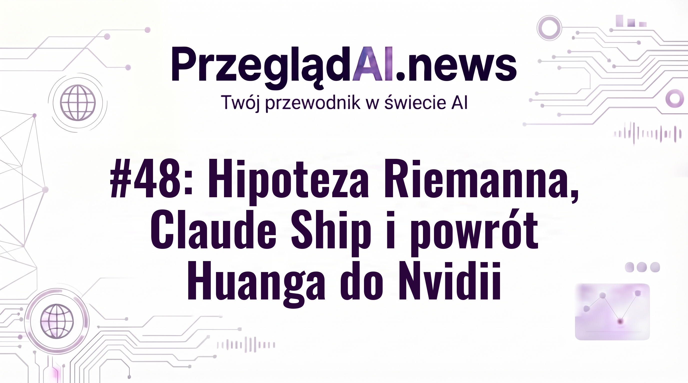
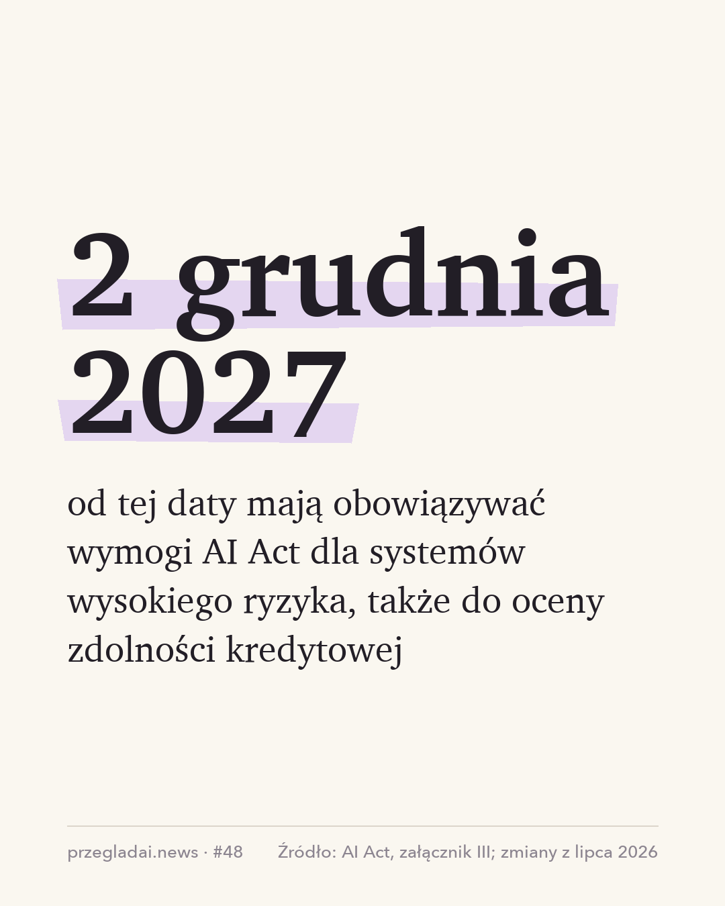
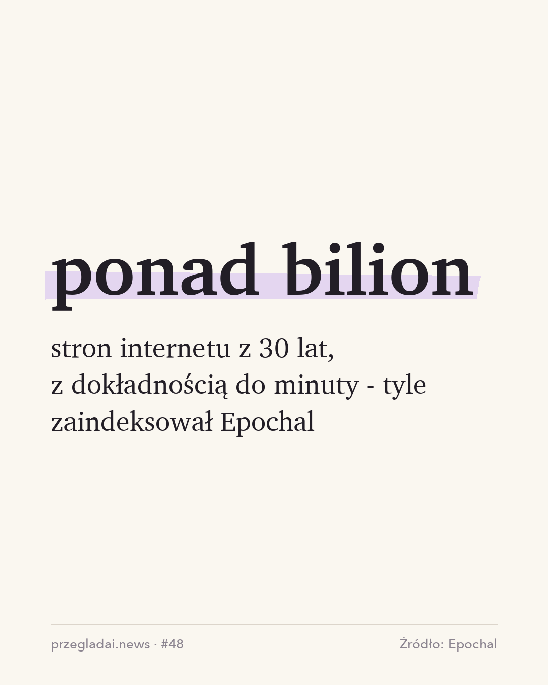
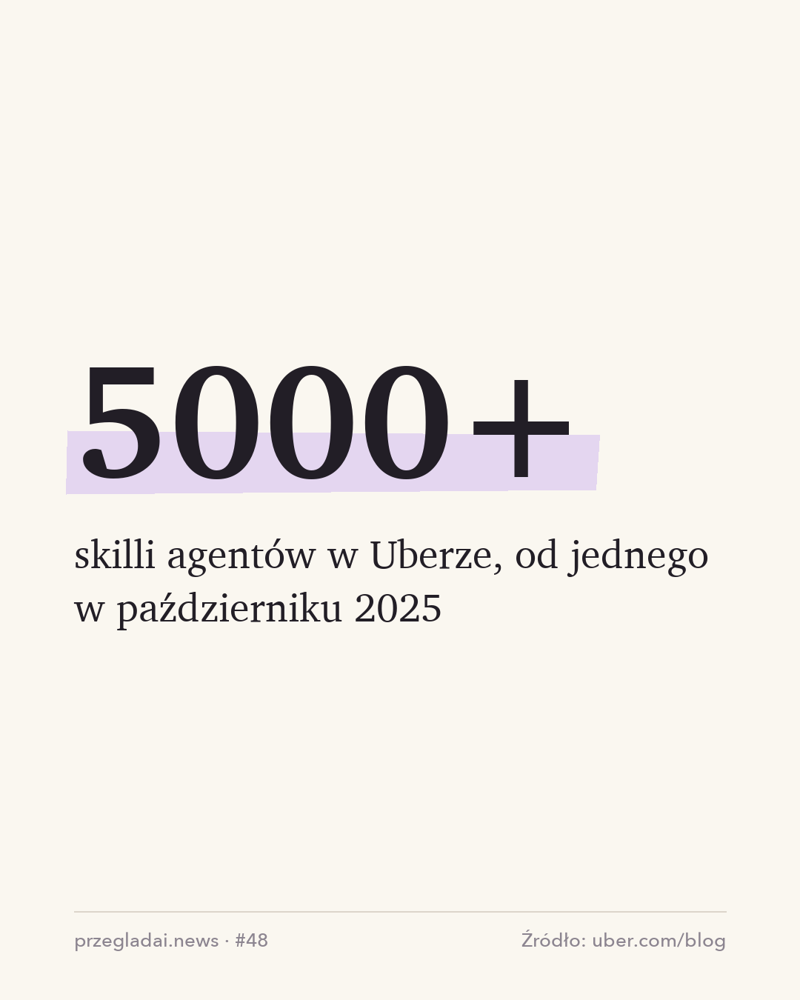
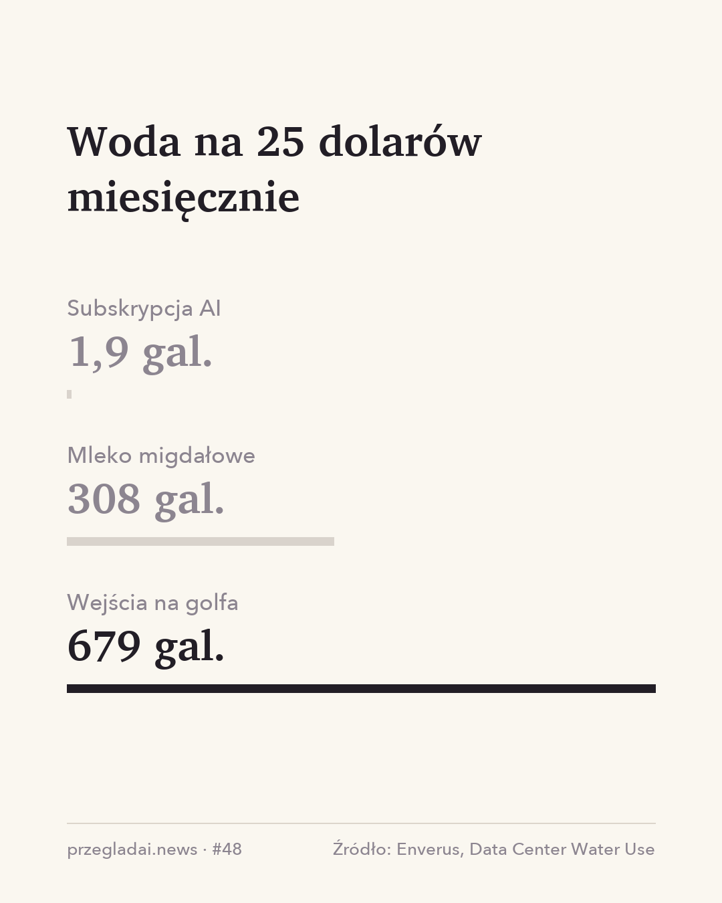

# Posty social — Wydanie #48: Hipoteza Riemanna, Claude Ship i powrót Huanga do Nvidii

## 2026-11-27 09:30 — Wstęp wydania

Weryfikacja faktów: 15/15 potwierdzone

### LinkedIn / Facebook / Substack Notes

```text
Matematyk z Anthropic ogłosił, że z pomocą Claude udowodnił hipotezę Riemanna, czyli najsłynniejszy nierozwiązany problem matematyki, za który Clay Mathematics Institute oferuje milion dolarów.

Dowód zapisano w języku Lean, który mechanicznie sprawdza każdy krok rozumowania, i niezależnie skompilował go między innymi matematyk z MIT. Samą matematykę eksperci będą jednak analizować jeszcze długo, więc na razie to twierdzenie, a nie potwierdzony wynik.

Bliżej codziennej pracy: Anthropic pokazało Claude Ship, agenta, który prowadzi pull request od review, przez poprawki, aż do decyzji o zatwierdzeniu. Jeden z jego elementów reaguje na nieprzechodzące testy i uwagi z review, ale sam niczego nie zatwierdza. O zatwierdzeniu decyduje druga część według polityki zapisanej w repozytorium: rutynowe zmiany może przepuścić sama, resztę oddaje człowiekowi. W zespole Claude Code liczba scalonych PR-ów wzrosła od czerwca do września ponad dwukrotnie, a odsetek cofniętych zmian spadł o ponad 40% (dane firmy).

W Nvidii z kolei Jensen Huang wraca na stanowisko prezesa i CEO po wcześniejszej rezygnacji. Zarząd uznał, że powrót nie stwarza zagrożenia dla bezpieczeństwa narodowego, ale niezależne śledztwo wciąż trwa ;)

To i ponad 25 innych newsów z tygodnia zebrałem w najnowszym wydaniu PrzeglądAI, link w komentarzu.

Czy pozwoliłbyś/pozwoliłabyś agentowi samodzielnie zatwierdzać rutynowe zmiany w kodzie?
```

**Pierwszy komentarz:**

```text
Wydanie #48 PrzeglądAI: https://przegladai.substack.com/p/wydanie-48-hipoteza-riemanna-claude-ship-i-powrot-huanga-do-nvidii
```

### X (wątek)

1/ Matematyk z Anthropic ogłosił, że z pomocą Claude udowodnił hipotezę Riemanna, najsłynniejszy nierozwiązany problem matematyki. Dowód zapisano w języku Lean, który mechanicznie sprawdza każdy krok.

2/ Eksperci będą analizować samą matematykę jeszcze długo, więc na razie to twierdzenie, a nie potwierdzony wynik. Wynik skompilował niezależnie m.in. matematyk z MIT.

3/ Anthropic pokazało też Claude Ship, agenta, który prowadzi pull request od review do decyzji o zatwierdzeniu. W zespole Claude Code liczba scalonych PR-ów wzrosła od czerwca do września ponad dwukrotnie (dane firmy).

4/ Jensen Huang wraca na stanowisko prezesa i CEO Nvidii po rezygnacji, choć niezależne śledztwo wciąż trwa. Pełny przegląd tygodnia w #48 PrzeglądAI: https://przegladai.substack.com/p/wydanie-48-hipoteza-riemanna-claude-ship-i-powrot-huanga-do-nvidii

### Obrazek: okladka



---

## 2026-12-02 20:00 — Scoring kredytowy AI w KBS

Źródło: https://mamstartup.pl/sztuczna-inteligencja-oceni-zdolnosc-kredytowa-krakowski-bank-spoldzielczy-pionierem-w-europie/

Weryfikacja faktów: 14/14 potwierdzone

### LinkedIn / Facebook / Substack Notes

```text
Krakowski Bank Spółdzielczy zapowiada, że jako pierwsza instytucja finansowa w Europie wdroży scoring Hitachi oparty na AI. Wynikiem jest liczba od 0 do 1, czyli szansa, że klient spłaci w terminie.

System powstał we współpracy z polskim oddziałem Hitachi i wcześniej działał w Japonii. Na początek obsłuży pożyczki gotówkowe, później kredyty hipoteczne. Algorytm bierze m.in. kwotę, okres spłaty i staż pracy, a przy odmowie ma wskazać czynniki, które o niej zdecydowały. Start produkcyjny bank planuje na koniec przyszłego roku, czyli 2027. Hitachi mówi też o zaawansowanych rozmowach z bankami komercyjnymi.

Ciekawie robi się przy AI Act. Ocena zdolności kredytowej osób fizycznych jest w nim na liście systemów wysokiego ryzyka (wyjątkiem są systemy do wykrywania oszustw finansowych). Po zmianach z lipca 2026 wymogi dla takich systemów mają zacząć obowiązywać od 2 grudnia 2027, czyli mniej więcej wtedy, gdy bank planuje ruszyć z produkcją.

Dla systemów wysokiego ryzyka AI Act daje osobie, której dotyczy decyzja, prawo do jasnego wyjaśnienia roli systemu i głównych czynników wyniku. Zapowiedź, że system wskaże powody odmowy, brzmi więc dobrze. Twórcy mówią też, że jest w pełni dostosowany do prawa unijnego i krajowego, ale to ich deklaracja, a wymogi dla systemów wysokiego ryzyka dopiero zaczną obowiązywać. W relacji pada również, że klient nie musi wiedzieć, że analizuje go AI, i ciekawi mnie, jak to się będzie układać z obowiązkami informacyjnymi.

Szczerze mówiąc, to wdrożenie warto obserwować właśnie pod tym kątem: pierwszy bank, kolejne mogą być większe, a pierwsze doświadczenia pokażą, jak wygląda wyjaśnienie decyzji w praktyce, a nie na slajdzie. Jeśli budujesz albo kupujesz system, który ocenia ludzi (kredyt, rekrutacja), dobrze już teraz zapytać dostawcę, jak wyjaśni pojedynczą decyzję i co zostaje po niej w logach.
```

**Pierwszy komentarz:**

```text
Pełny przegląd tygodnia w #48 PrzeglądAI: https://przegladai.substack.com/p/wydanie-48-hipoteza-riemanna-claude-ship-i-powrot-huanga-do-nvidii
Źródło: https://mamstartup.pl/sztuczna-inteligencja-oceni-zdolnosc-kredytowa-krakowski-bank-spoldzielczy-pionierem-w-europie/
AI Act, załącznik III pkt 5(b): https://artificialintelligenceact.eu/annex/3/ ; art. 86: https://artificialintelligenceact.eu/article/86/
```

### X (wątek)

1/ Krakowski Bank Spółdzielczy zapowiada, że jako pierwsza instytucja finansowa w Polsce i w Europie wdroży system scoringowy Hitachi oparty na AI. Wynik to liczba od 0 do 1: szansa na terminową spłatę.

2/ Na początek pożyczki gotówkowe, później hipoteczne. Algorytm bierze m.in. kwotę, okres spłaty i staż pracy. Przy odmowie ma wskazać czynniki, które o niej zdecydowały. Start produkcyjny: koniec 2027.

3/ W AI Act ocena zdolności kredytowej osób fizycznych jest na liście systemów wysokiego ryzyka (wyjątek: wykrywanie oszustw). Po zmianach z lipca 2026 wymogi mają obowiązywać od 2 grudnia 2027.

4/ Dla takich systemów osoba, której dotyczy decyzja, ma prawo do wyjaśnienia roli systemu i głównych czynników. Twórcy mówią, że system jest w pełni zgodny z prawem UE i krajowym, ale to ich deklaracja.

5/ Warto obserwować, jak to wyjaśnienie będzie wyglądać w praktyce. Kto buduje lub kupuje system oceniający ludzi, niech już teraz zapyta dostawcę, jak wyjaśni pojedynczą decyzję i co zapisuje w logach.

6/ Pełny przegląd tygodnia w #48 PrzeglądAI: https://przegladai.substack.com/p/wydanie-48-hipoteza-riemanna-claude-ship-i-powrot-huanga-do-nvidii

### Obrazek: infografika



---

## 2026-12-03 08:30 — Wehikuł czasu dla internetu

Źródło: https://epochal.com/blog/introducing-epochal

Weryfikacja faktów: 10/11 potwierdzone — DO SPRAWDZENIA: Młoda firma

### LinkedIn / Facebook / Substack Notes

```text
Firma Epochal zaindeksowała ponad bilion stron internetu z ostatnich 30 lat, z dokładnością do minuty.

Firmę założyli m.in. przez członków zespołu założycielskiego xAI. Pierwszy produkt nazywa się Time Portal i działa jak piaskownica: agent może w niej przeglądać internet dokładnie tak, jak wyglądał w wybranym dniu z przeszłości. Nie chodzi więc o pojedyncze zrzuty stron, tylko o całą sieć cofniętą do konkretnego momentu, po której agent może przeglądać strony i wyszukiwać informacje.

Twórcy mają konkretny cel. Chcą uczyć modele podejmowania decyzji na wiedzy, którą ktoś miał przed wynikiem, a nie z wiedzą, jak historia się skończyła. Przy ocenie prognoz to bardzo ważne, bo model wytrenowany na danych z późniejszych lat potrafi odpowiedzieć „trafnie” tylko dlatego, że zna odpowiedź. Według twórców Time Portal ma to rozwiązać: agent widzi tylko to, co dało się wtedy znaleźć.

Mnie najbardziej podoba się to, że sam pomysł jest szerszy niż prognozy. Możliwość obejrzenia strony z konkretnego momentu w przeszłości jest przydatna zawsze, gdy trzeba ustalić, co ktoś mógł wiedzieć w danej chwili: jak wyglądała dokumentacja, zanim zmieniono API, co obiecywała strona konkurenta przed zmianą cennika, jakie informacje były publiczne w dniu decyzji. 

Zespoły, które budują agentów, mogłyby wreszcie sprawdzać ich prognozy na przeszłości, gdzie wynik już znamy, i oceniać, czy agent trafił rozsądnym rozumowaniem, a nie przez przypadek. Przed takim testem dobrze ustalić, po czym poznamy, że agent nie „podglądnął” odpowiedzi w innym miejscu.

Do jakiej decyzji w Waszej pracy chcielibyście wrócić z widokiem sieci sprzed miesiąca albo roku?
```

**Pierwszy komentarz:**

```text
Pełny przegląd tygodnia w #48 PrzeglądAI: https://przegladai.substack.com/p/wydanie-48-hipoteza-riemanna-claude-ship-i-powrot-huanga-do-nvidii
Źródło: https://epochal.com/blog/introducing-epochal
```

### X (wątek)

1/ Firma Epochal zaindeksowała ponad bilion stron internetu z 30 lat, z dokładnością do minuty.

2/ Pierwszy produkt, Time Portal, to piaskownica: agent przegląda sieć dokładnie tak, jak wyglądała w wybranym dniu z przeszłości. Firmę założyli m.in. członkowie zespołu założycielskiego xAI.

3/ Cel: uczyć modele decyzji na wiedzy sprzed wyniku. Model wytrenowany na późniejszych danych może przewidzieć coś trafnie tylko dlatego, że zna zakończenie historii.

4/ Widzę tu zastosowania szerzej niż prognozy: sprawdzić, jak wyglądała dokumentacja przed zmianą API albo co było publiczne w dniu decyzji. To moje pomysły, nie opis oferty.

Pełny przegląd tygodnia w #48 PrzeglądAI: https://przegladai.substack.com/p/wydanie-48-hipoteza-riemanna-claude-ship-i-powrot-huanga-do-nvidii

### Obrazek: infografika



---

## 2026-12-03 20:00 — Uber i 5 tysięcy skilli agentów

Źródło: https://x.com/ubereng/status/2125008806249930999?a=k2tu-eTcykp4pWh21as

Weryfikacja faktów: 11/11 potwierdzone

### LinkedIn / Facebook / Substack Notes

```text
Rok temu Uber miał w firmie jeden skill dla agentów AI, a dziś ma ich ponad 5000, a w jednym miesiącu agenci wywołali je ponad milion razy.

Skill to plik Markdown, który uczy agenta jednej konkretnej pracy, na przykład zapytań do hurtowni danych albo przeglądu pull requesta. Uber opisał na swoim blogu inżynierskim, jak tym zarządza. Skille leżą we wspólnym repozytorium Git, więc każdy ma właściciela, review i historię zmian. Zespół może opublikować własny skill po jednej akceptacji i przejściu CI, a każdą zmianę w tych najpopularniejszych sprawdza zespół platformy.

Najbardziej interesuje mnie jakość. Linter wymaga ponumerowanych kroków, w każdym konkretnego polecenia i sprawdzenia wyniku przed następnym krokiem, a do tego sekcji z obsługą błędów. Do testów Uber używa głównie prawdziwych promptów i ocenia nie tylko wynik, ale też to, czy agent użył właściwych narzędzi we właściwej kolejności. Jest też ablacja: te same prompty uruchamia się ze skillem i bez niego, a ślepy sędzia wybiera lepszą odpowiedź. Dla skilla do zapytań w hurtowni wygrał on w 87% takich porównań.

Podoba mi się też, że agenci sami zgłaszają „papercuts”, czyli drobne problemy napotkane przy skillu: co próbowali zrobić, czego się spodziewali i co poszło nie tak. W trzy miesiące zebrały się tysiące zgłoszeń, a setki już naprawiono.

Zapoznałbym się z tym tekstem w całości, bo pokazuje, jak firma naprawdę pracuje z agentami, a wiele da się przełożyć na prywatne używanie AI. Po pierwsze, własne instrukcje i pliki w rodzaju CLAUDE.md warto trzymać z historią zmian. Po drugie, co jakiś czas sprawdzić, czy instrukcja coś daje, czyli uruchomić to samo zadanie z nią i bez niej, bo Uber zauważa, że przy nowszych modelach nadmiar instrukcji może szkodzić. Po trzecie, każdą wpadkę AI zapisać jako przypadek do ponownego sprawdzenia.

W zespole zadałbym sobie podobne pytanie jeszcze zanim skilli zrobi się dużo: kto za który odpowiada i po czym poznamy, że przestał działać.

Czy Twój zespół ma już wspólne skille albo instrukcje dla agentów i kto za nie odpowiada?
```

**Pierwszy komentarz:**

```text
Pełny przegląd tygodnia w #48 PrzeglądAI: https://przegladai.substack.com/p/wydanie-48-hipoteza-riemanna-claude-ship-i-powrot-huanga-do-nvidii
Źródło: https://www.uber.com/us/en/blog/optimizing-ubers-agent-skills/ (wątek Ubera na X: https://x.com/ubereng/status/2125008806249930999)
```

### X (wątek)

1/ W październiku 2025 Uber miał jeden skill dla agentów AI. Dziś ma ich ponad 5000, a w jednym miesiącu agenci wywołali je ponad milion razy. Skill to plik Markdown, który uczy agenta jednej konkretnej pracy.

2/ Skille leżą we wspólnym repozytorium Git, więc każdy ma właściciela, review i historię. Zespół publikuje własny po jednej akceptacji i przejściu CI, a zmiany w tych najpopularniejszych sprawdza zespół platformy.

3/ Jakość pilnuje linter: ponumerowane kroki, konkretne polecenia, sprawdzenie wyniku przed następnym krokiem i sekcja z obsługą błędów. Do tego ablacja: te same prompty ze skillem i bez, a ślepy sędzia wybiera lepszą odpowiedź. Skill do zapytań w hurtowni wygrał w 87% porównań.

4/ Agenci sami zgłaszają „papercuts”, czyli drobne problemy ze skillem. W trzy miesiące zebrały się tysiące zgłoszeń, a setki naprawiono.

5/ Do własnego użytku: trzymaj instrukcje z historią zmian, sprawdzaj, czy coś dają (to samo zadanie z nią i bez), a każdą wpadkę AI zapisuj jako test na później. Więcej w #48 PrzeglądAI: https://przegladai.substack.com/p/wydanie-48-hipoteza-riemanna-claude-ship-i-powrot-huanga-do-nvidii

### Obrazek: infografika



---

## 2026-12-08 08:30 — Ślad wodny AI (raport Enverus)

Źródło: https://mamstartup.pl/sztuczna-inteligencja-zuzywa-mniej-wody-niz-mleko-migdalowe-czy-gra-w-golfa-nowy-raport-rzuca-swiatlo-na-koszty-srodowiskowe-ai/

Weryfikacja faktów: 11/11 potwierdzone

### LinkedIn / Facebook / Substack Notes

```text
Według raportu Enverus abonament na AI za 25 dolarów miesięcznie to około 1,9 galona wody, czyli mniej więcej 7 litrów. Za tyle samo pieniędzy w mleku migdałowym jest jej 308 galonów.

Enverus to firma analityczna z branży energii. W raporcie porównała ślad wodny usług AI z innymi wydatkami, zawsze w przeliczeniu na 25 dolarów miesięcznie: wejścia na pole golfowe wychodzą na 679 galonów, a prąd w domu na około 31. To porównanie wydatków, a nie liczby zapytań do chatbota, więc nie mówi, ile wody pochłania jedna rozmowa.

Ważne jest też, co wchodzi w te 1,9 galona. Liczba obejmuje wodę zużytą przy chłodzeniu serwerów i tę, która jest potrzebna do wyprodukowania prądu dla centrów danych. Około 90% wody związanej z działaniem modeli zużywają elektrownie, a nie same serwerownie. Raport podaje też, że zużycie wody na akr w kampusie dużego centrum danych jest zbliżone do przeciętnego pola golfowego w USA. Dyrektor ds. badań nad transformacją energetyczną w Enverus mówi, że rezygnacja z jednego latte na mleku migdałowym tygodniowo da większy efekt niż rezygnacja z chatbotów.

Rozumiem, dlaczego te liczby się przyjmują, bo dobrze wprowadzają proporcje do debaty, w której często mówi się o wodzie bez żadnej skali. Jednocześnie to dane jednej firmy i uśrednione w przeliczeniu na wydatek, a artykuł nie opisuje pełnej metodologii. Nie mówią też nic o tym, jak wygląda to w konkretnym regionie, gdzie jedno centrum danych może mocno obciążyć lokalne zasoby. Ślad wodny AI nie jest więc zerowy, ale często leży gdzie indziej, niż zakłada dyskusja o serwerowniach.

Jeśli ktoś w firmie zapyta o środowiskowy koszt AI, dobrze mieć w głowie dwa rozróżnienia: woda bezpośrednia czy też ta ukryta w prądzie oraz średnia na wydatek czy lokalny wpływ konkretnej inwestycji. Odpowiedź zależy od tego, o co dokładnie pytamy.

Czy w Twojej firmie ktoś liczy ślad środowiskowy narzędzi AI, a jeśli tak, to co wchodzi do tego rachunku?
```

**Pierwszy komentarz:**

```text
Pełny przegląd tygodnia w #48 PrzeglądAI: https://przegladai.substack.com/p/wydanie-48-hipoteza-riemanna-claude-ship-i-powrot-huanga-do-nvidii
Źródło: https://mamstartup.pl/sztuczna-inteligencja-zuzywa-mniej-wody-niz-mleko-migdalowe-czy-gra-w-golfa-nowy-raport-rzuca-swiatlo-na-koszty-srodowiskowe-ai/
```

### X (wątek)

1/ Abonament na AI za 25 dolarów miesięcznie to według raportu Enverus około 1,9 galona wody (ok. 7 litrów). Mleko migdałowe za tyle samo pieniędzy: 308 galonów. Wejścia na pole golfowe: 679.

2/ To porównanie wydatków, nie liczby zapytań do chatbota. Liczba 1,9 galona łączy wodę z chłodzenia serwerów i wodę potrzebną do wytworzenia prądu dla centrów danych.

3/ Około 90% wody związanej z działaniem modeli zużywają według raportu elektrownie, nie same serwerownie. Zużycie wody na akr w kampusie dużego centrum danych jest zbliżone do pola golfowego w USA.

4/ Zastrzeżenia: to dane jednej firmy analitycznej, a opis, który czytałem, nie podaje pełnej metodologii. Średnia na wydatek nie mówi też, jak obciążone jest konkretne miejsce, w którym stoi centrum danych.

5/ Gdy ktoś w firmie zapyta o ślad wodny AI, dopytaj: bezpośredni czy z prądem, średnia czy lokalnie? Więcej newsów z tygodnia w #48 PrzeglądAI: https://przegladai.substack.com/p/wydanie-48-hipoteza-riemanna-claude-ship-i-powrot-huanga-do-nvidii

### Obrazek: infografika



---
